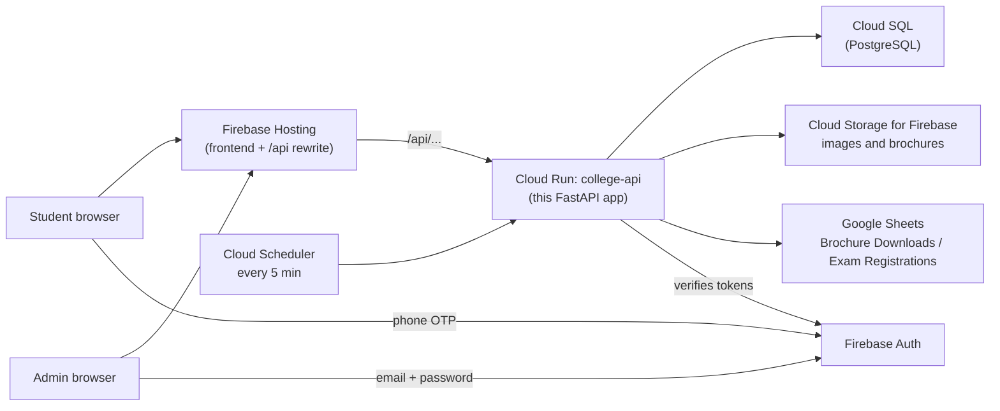

# 1. Architecture

## The big picture



- **Firebase Hosting** serves the website and forwards every `/api/...` request to Cloud Run. The website and API share one domain.
- **Cloud Run** runs this backend in a container. It scales automatically and costs nothing when idle (staging).
- **PostgreSQL (Cloud SQL)** stores everything the admin manages: settings, courses, batches, banners, announcements, gallery, videos, brochure metadata and exam questions.
- **Firebase Storage** stores image files (public) and brochure PDFs (private; students get them only through the API after OTP).
- **Google Sheets** receives one row per brochure download and per exam registration. Student lead details are not persisted in PostgreSQL; if Sheets is briefly unavailable, the row is held temporarily in the retry queue and Cloud Scheduler retries it every 5 minutes. The backend only "verifies" the tokens Firebase issues.
- **Firebase Auth** handles the single administrator's Google Sign-In and the student phone OTP.
- **Admin SPA** is served at `/admin` from this FastAPI service. It uses the
  Firebase Web SDK only to obtain an administrator's ID token; all data changes
  still go through the existing protected FastAPI APIs.

## Modules

Every feature is a self-contained folder in `app/modules/<name>/`:

| File | Purpose |
|---|---|
| `__init__.py` | Declares the module: name, routers, which other modules it needs |
| `models.py` | Database tables owned by the module |
| `schemas.py` | Request/response shapes and their validation (Pydantic) |
| `service.py` | Business logic (no HTTP code) |
| `router.py` | HTTP endpoints (`public_router`, `admin_router`, `internal_router`) |

Tests live in `tests/modules/test_<name>.py`.

| Module | Public endpoints (`/api/v1`) | Admin endpoints (`/api/v1/admin`) | Needs |
|---|---|---|---|
| `admin_auth` | n/a | `/me` | n/a |
| `site_settings` | n/a | `/site-settings` | `admin_auth` |
| `courses` | n/a | `/courses` | `admin_auth` |
| `batches` | n/a | `/batches` | `admin_auth`, `courses` |
| `brochures` | Disabled pending the verified `brochures` table | n/a | n/a |
| `banners` | n/a | `/banners` | `admin_auth`, `courses` |
| `announcements` | n/a | `/announcements` | `admin_auth` |
| `gallery` | n/a | `/gallery` | `admin_auth` |
| `videos` | n/a | `/videos` | `admin_auth` |
| `registration` | n/a | `/registration/options` | n/a |
| `lead_sync` | Disabled pending the verified `pending_sheet_rows` table | n/a | n/a |
| `brochure_download` | Disabled pending the verified `brochures` table | n/a | n/a |
| `exam` | `/exam/info`, `/exam/start`, `/exam/submit` | `/exam` | `admin_auth`, `registration` |
| `public_site` | `/public/site` | n/a | most content modules |

Shared building blocks live in `app/core/`:

- `config.py`: settings.
- `database.py`: database sessions.
- `error.py`: standard error format.
- `identity.py`: Firebase token checks.
- `storage.py`: files.
- `sheets.py`: Google Sheets.
- `uploads.py` and `media.py`: file validation and image resizing.
- `rate_limit.py`: abuse protection.
- `tokens.py`: exam attempt tokens.
- `logging.py` and `middleware.py`: logs and security headers.

Each one has two implementations: a real one (Firebase, Google) and a fake one for local development and tests.

## How a request flows

1. The browser calls `https://college.com/api/v1/...`; Firebase Hosting forwards it to Cloud Run.
2. Middleware adds a request ID and security headers, and logs the request.
3. Router dependencies run first:
   - `require_admin` checks the Firebase token, verified email and the admin allow-list.
   - `require_app_check` checks that the call comes from the real website.
   - `rate_limit` slows down abusive traffic.
4. The service function does the work and the database session commits.
5. Errors anywhere become a standard JSON error (see [API reference](09-api-reference.md#errors)).

## Important design choices

| Choice | Why |
|---|---|
| One codebase, one service, many modules | Simple to deploy and run. Modules can still be split out later (below) |
| Synchronous SQLAlchemy | Easier to read and debug. FastAPI runs it in a thread pool, and Cloud Run adds containers when busy |
| Exam answers never leave the server before submit | Students can't read answers from the browser. Grading happens on submit |
| No exam results stored | Requirement. Progress is kept in the student's browser only |
| Attempt tokens signed by the server | The 150-minute limit and the chosen set can't be tampered with |
| Student details only in Google Sheets | Requirement. The admin manages that data directly in Sheets |
| Images re-encoded to WebP | Strips hidden metadata, blocks malicious files, and makes pages fast |
| Public content cached 60 seconds at the CDN | Fast website, low cost. Admin edits appear within about a minute |

## Splitting a module into its own service later

Example: run the exam on its own Cloud Run service because it gets heavy traffic in admission season.

1. Deploy the **same image** as a second service, say `college-exam`, with `ENABLED_MODULES=registration,exam,admin_auth` (copy `config/production.env.yaml` to a new file and change that line).
2. Remove `exam` from `ENABLED_MODULES` of the main service (list the other modules).
3. In the frontend's `firebase.json`, send exam traffic to the new service. Put it **before** the general rule:

   ```json
   [
     { "source": "/api/v1/exam/**", "run": { "serviceId": "college-exam", "region": "asia-south1" } },
     { "source": "/api/v1/admin/exam/**", "run": { "serviceId": "college-exam", "region": "asia-south1" } },
     { "source": "/api/**", "run": { "serviceId": "college-api", "region": "asia-south1" } }
   ]
   ```

4. Both services share the same database, so no data moves. Scale each one independently with its own `--max-instances`.

## Adding a new module

1. Create `app/modules/<name>/` with the five files above (copy a small module such as `videos`).
2. Register it in `app/modules/__init__.py` (`ALL_MODULES`) and its module in `app/models.py`.
3. Create a migration: `alembic revision --autogenerate -m "add <name>"`, review it, then use the explicit branch target appropriate to that database; never use generic `head` with both branches present.
4. Add `tests/modules/test_<name>.py`.
